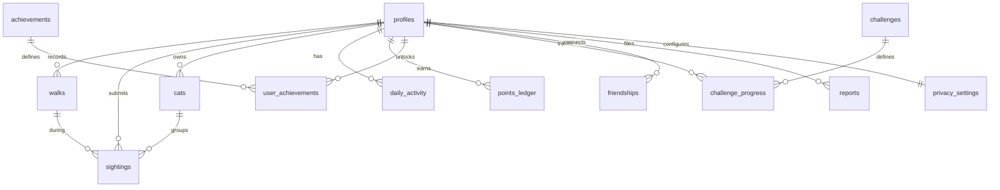

# 00 — Architecture & Golden Rules

> **Read this file at the start of every phase.** It defines the stack, folder layout, data model, and the non-negotiable rules. If a phase file contradicts this file, stop and ask.

---

## 1. Tech stack (decided)

| Concern | Choice | Why |
|---|---|---|
| App framework | **Expo SDK 58**, React Native 0.88, React 19, TypeScript (strict) | Already scaffolded. Cloud builds via EAS — no Mac needed. |
| Navigation | **Expo Router** (`src/app/`) | File-based routes, typed routes enabled. |
| Styling | **NativeWind v4** + Tailwind v3 (`className`) | Configured in Phase 0 setup. |
| Native UI controls | **`@expo/ui`** for switches, pickers, sheets, menus | Expo-recommended, real SwiftUI / Compose. |
| Backend | **Supabase** (Postgres + Auth + Storage + Edge Functions) | First-class Expo integration (`eas integrations:supabase:connect`), RLS for privacy. |
| Server state | **TanStack Query** | Caching, retries, offline-friendly. |
| Client state | **Zustand** | Active-walk state machine, UI state. |
| Local persistence | **`expo-sqlite`** | Buffer GPS points offline; also stores the Supabase session. |
| Validation | **Zod** | Validate env, API payloads, forms. |
| Location | **`expo-location`** + **`expo-task-manager`** | Foreground + background GPS during a walk. |
| Maps | **`expo-maps`** (Apple Maps on iOS 17+, Google Maps on Android) | Expo module, polylines supported. |
| Camera | **`expo-camera`** + **`expo-image-manipulator`** + **`expo-crypto`** | Capture, resize/strip metadata, hash. |
| Health | **HealthKit** (iOS) / **Health Connect** (Android) via community libs with config plugins | Steps & calories. Requires dev build. |
| Images | **`expo-image`** | Fast cached image display. |
| Testing | **jest-expo** + React Native Testing Library | Unit-test pure logic (distance, points, rules). |
| Builds | **EAS Build / Submit / Update** | iOS builds in the cloud. |

> If a library listed above turns out to be incompatible with SDK 58 at implementation time, **stop and report** instead of silently swapping it.

---

## 2. Folder structure

```
src/
  app/                      # ROUTES ONLY (screens + _layout files)
    _layout.tsx             # root: providers, fonts, splash, auth gate
    (auth)/                 # sign-in, sign-up, onboarding
    (tabs)/                 # main tab navigator
      _layout.tsx
      index.tsx             # Home / Today
      walk.tsx              # Start / active walk
      collection.tsx        # Cat collection
      social.tsx            # Friends & leaderboards
      profile.tsx           # Profile & settings entry
    walk/[id].tsx           # walk detail
    sighting/capture.tsx    # camera (modal)
    cat/[id].tsx            # cat detail
    settings/...            # privacy, permissions, account
  features/                 # feature modules (NO routes here)
    auth/
    walk/
    health/
    sightings/
    collection/
    gamification/
    social/
    privacy/
      components/  hooks/  api.ts  store.ts  types.ts  utils.ts  __tests__/
  components/ui/            # shared design-system primitives (Button, Card, Text, Screen…)
  lib/                      # supabase client, query client, env, db (sqlite), analytics
  constants/                # theme tokens, config constants (limits, thresholds)
  hooks/                    # generic hooks only
supabase/
  migrations/               # SQL migrations (source of truth for the schema)
  functions/                # Edge Functions (Deno)
  seed.sql                  # achievement / challenge definitions
docs/                       # these docs
```

**Rules**
- Every file in `src/app/` is a screen. Keep logic in `src/features/*` and import it.
- A feature may import from `components/ui`, `lib`, `constants`, and **other features' public `index.ts` only**.
- Generated Supabase types live in `src/lib/database.types.ts` (regenerate after each migration).

---

## 3. Data model (target MVP schema)

Built incrementally — each phase adds only its tables. All tables have **RLS enabled**.



| Table | Phase | Purpose (key columns) |
|---|---|---|
| `profiles` | 2 | `id (=auth.users.id)`, `username` (unique), `display_name`, `avatar_url`, `weight_kg?`, `created_at` |
| `walks` | 3 | `user_id`, `started_at`, `ended_at`, `duration_s`, `moving_time_s`, `distance_m`, `route_polyline` (encoded, private), `status`, `client_id` (idempotency) |
| `daily_activity` | 4 | `user_id`, `date`, `steps`, `active_kcal`, `kcal_source` (`health`/`estimate`), `source` |
| walk columns | 4 | `steps?`, `kcal?`, `kcal_source?` added to `walks` |
| `sightings` | 6–7 | `user_id`, `walk_id?`, `cat_id?`, `photo_path`, `sha256`, `phash`, `taken_at`, `area_geohash?` (≤5 chars, opt-in), `status` (`pending`/`accepted`/`rejected`/`flagged`), `reject_reason?`, `cat_confidence?` |
| `cats` | 8 | `user_id`, `nickname`, `cover_sighting_id`, `sighting_count`, `first_seen_at`, `last_seen_at` |
| `points_ledger` | 9 | `user_id`, `amount`, `reason`, `source_type`, `source_id`, **unique(`user_id`,`source_type`,`source_id`)** |
| `achievements` / `user_achievements` | 9 | definitions (seeded) / unlocks |
| `challenges` / `challenge_progress` | 9 | definitions with `period` (`daily`/`weekly`), `metric`, `target` / per-user progress |
| `friendships` | 10 | `requester_id`, `addressee_id`, `status` (`pending`/`accepted`/`blocked`) |
| `privacy_settings` | 10–11 | `share_walks_with_friends`, `show_on_leaderboard`, `save_sighting_area` … (defaults **private**) |
| `reports` | 11 | `reporter_id`, `target_type`, `target_id`, `reason`, `status` |

Storage buckets: `sighting-photos` (private, path `{user_id}/{sighting_id}.jpg`), `avatars` (public-read).

---

## 4. Golden rules (never break these)

### Product & safety
1. **Walking is always valuable.** A walk with zero cats still earns progress.
2. **Never reward approaching, chasing, touching, feeding, or locating cats.** No location-based cat challenges. Camera flash is always **off**.
3. **Privacy by default.** Routes are private. No live location sharing — ever. No exact cat coordinates stored for sharing (only an optional coarse geohash).
4. **Honest data.** Calories always labelled as *estimate* + source. Never present as medical advice.
5. **No shaming.** No punishing streaks, no "you failed" copy.

### Engineering
6. **Points, achievements, validation and leaderboards are computed server-side** (Postgres functions / Edge Functions). The client never decides how many points it gets.
7. **Every write is idempotent.** Walks and sightings carry a client-generated UUID so retries never duplicate.
8. **Offline-first walks.** GPS points go to SQLite first; upload happens on finish and is retried.
9. **RLS on every table.** A user can only read their own rows unless a policy explicitly allows friends.
10. **No secrets in the app.** Only `EXPO_PUBLIC_SUPABASE_URL` and `EXPO_PUBLIC_SUPABASE_PUBLISHABLE_KEY`. Vision API keys live in Edge Function secrets.
11. **Install with `npx expo install`**, check SDK 58 docs before using any Expo API, never edit `ios/` or `android/` (CNG — configure in `app.json`).
12. **Typed end-to-end.** No `any`. Use generated DB types + Zod at boundaries.
13. **Small files.** Screens < ~200 lines; extract components/hooks.
14. **Accessibility.** Every touchable has `accessibilityLabel`; text respects font scaling; minimum 44pt touch targets.

---

## 5. Conventions

- **Naming:** files `kebab-case.tsx`; components `PascalCase`; hooks `useX`; DB columns `snake_case`.
- **Units:** store meters, seconds, kcal, UTC timestamps. Convert only in the UI (`formatDistance`, `formatDuration`).
- **Config constants** (thresholds, limits, point values) live in `src/constants/config.ts` (client display) and mirrored in SQL (authoritative).
- **Errors:** user-facing messages are friendly; log technical details via `lib/logger.ts`.
- **Env:** validated in `src/lib/env.ts` with Zod; app fails fast in dev if missing.
- **Commits:** Conventional Commits, one phase = one or more focused commits.

---

## 6. Running & testing without a Mac

| Need | How |
|---|---|
| UI-only work | `npx expo start` + Expo Go (until native modules are added) |
| Native modules (location background, maps, health, camera) | **Development build**: `npx eas-cli@latest build --profile development --platform android` (installs on an Android phone directly). iOS dev builds need a paid Apple Developer account + registered device (`eas device:create`). |
| JS changes after a dev build | `npx expo start --dev-client` (hot reload, no rebuild) |
| Rebuild needed when | a package with native code is added, or `app.json` plugins/permissions change |
| iOS without iPhone | EAS Simulator (cloud) if available on the account |
