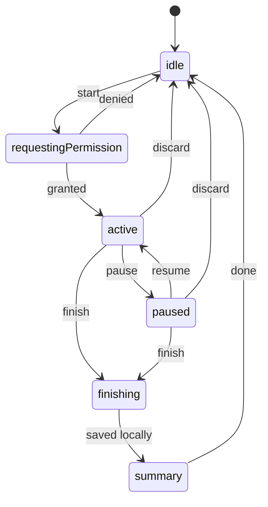

# Phase 3 — GPS Walk Tracking (Core Loop)

## Goal
A user can **start, pause, resume, finish, or discard** a walk. The app records the route with GPS (including when the screen is locked), shows live distance / time / pace and a map, and saves the walk to their private history. This is the most important phase — reliability over features.

## Prerequisites
- Phase 2 complete (signed-in user, Supabase, migrations workflow).
- Development build working (Phase 1.7). **Background location does not work in Expo Go.**

## Out of scope
- Steps & calories (Phase 4).
- Walk history list & dashboard (Phase 5) — only a simple post-walk summary here.
- Camera button (Phase 6) — leave a disabled placeholder slot in the active-walk UI.
- Points/achievements (Phase 9).

## Packages
```bash
npx expo install expo-location expo-task-manager expo-maps expo-keep-awake
```
Add `@mapbox/polyline` (or write a small encoder) for route encoding — verify it works in RN.

`app.json` plugin config (check SDK 58 docs for exact keys):
- `expo-location`: `locationWhenInUsePermission` text ("…to record your walking route while a walk is active"), `isIosBackgroundLocationEnabled: true`, `isAndroidBackgroundLocationEnabled: true` (foreground service for Android).
- `expo-maps`: Android Google Maps API key in `android.config.googleMaps.apiKey` (via EAS env var, not committed). iOS uses Apple Maps (iOS 17+) — set `ios.deploymentTarget` accordingly via `expo-build-properties` if required.
- **Rebuild the dev client after this phase's config changes.**

## Data / schema
Migration `<ts>_walks.sql`:
- `walks`: `id uuid pk`, `client_id uuid unique` (idempotency), `user_id`, `started_at`, `ended_at`, `duration_s int` (wall clock), `moving_time_s int` (excludes pauses), `distance_m numeric`, `avg_speed_mps numeric`, `route_polyline text` (encoded, simplified), `point_count int`, `status text check in ('completed')`, `created_at`.
- RLS: owner-only `select/insert/delete`. No update except via future server functions.
- Server-side sanity check (trigger or function `submit_walk`): reject if `avg_speed_mps > 4.2` (~15 km/h — running/vehicle), if `distance_m < 0`, or `ended_at < started_at`. Flag (`is_suspicious bool`) rather than hard-fail for borderline cases.

Local SQLite (`src/lib/db.ts`, via `expo-sqlite`):
- `active_walk` (single row: id, state, started_at, paused intervals JSON)
- `walk_points` (`walk_id`, `lat`, `lng`, `accuracy`, `speed`, `timestamp`)
- `pending_uploads` (`walk_id`, `payload`, `attempts`, `last_error`)

## Architecture



- `src/features/walk/store.ts` — Zustand store implementing the state machine above; persists state to SQLite so an app kill/restart **recovers the active walk**.
- `src/features/walk/location-task.ts` — `TaskManager.defineTask` at **module top level**, imported from the root layout so it's registered on cold start. Writes points to SQLite (never to React state directly).
- `src/features/walk/geo.ts` — pure functions: `haversine`, `totalDistance(points)`, `filterPoints` (drop accuracy > 30 m, drop jumps implying speed > 8 m/s, drop points while paused), `simplifyRoute` (Douglas-Peucker), `encodePolyline`. **Fully unit tested.**
- `src/features/walk/sync.ts` — uploads finished walks from `pending_uploads` with retry/backoff; triggered on finish, app foreground, and network regain.

## Tasks
- [ ] 3.1 SQLite schema + `db.ts` helpers.
- [ ] 3.2 `geo.ts` with tests (distance over a known route, jitter filtering, simplification keeps start/end).
- [ ] 3.3 Permission flow: explain screen *before* the OS prompt ("We only use location while a walk is active. Your route is private."). Request foreground first; request background only when starting a walk, explaining why (screen-off tracking). Handle "denied" and "approximate only" with a helpful screen + link to Settings.
- [ ] 3.4 Location task + start/stop updates (`accuracy: High`, `distanceInterval ≈ 5 m`, `activityType: Fitness`, Android `foregroundService` notification "Walk in progress").
- [ ] 3.5 Walk store (state machine) with SQLite persistence & crash recovery prompt ("Resume your unfinished walk?").
- [ ] 3.6 **Walk tab — idle:** big "Start walk" button, GPS status indicator.
- [ ] 3.7 **Active walk screen:** live `StatTile`s (time, distance, pace), map with polyline + current position, Pause/Resume, Finish (confirm), Discard (confirm). Disabled camera button placeholder. Keep screen awake optional (`expo-keep-awake`).
- [ ] 3.8 Timer derives from timestamps (not `setInterval` accumulation) so it stays correct after backgrounding.
- [ ] 3.9 **Finish:** compute final stats, simplify + encode route, save to `pending_uploads`, show **Summary screen** (map, distance, duration, pace). Walks under 50 m or 1 min: offer "Discard short walk?".
- [ ] 3.10 Sync to Supabase with idempotent `client_id`; show "Saved" / "Will upload when online".
- [ ] 3.11 GPS-lost handling: banner "Weak GPS signal" when no fix for 30 s; don't add distance across gaps > 60 s unless straight-line speed is plausible.

## Acceptance criteria
- [ ] A 10-minute real walk with phone locked in a pocket records a continuous route on both Android and iOS.
- [ ] Distance within ~5% of a known route (compare with Google Maps measurement).
- [ ] Pausing stops distance/time accumulation; resuming continues correctly.
- [ ] Killing the app mid-walk → reopening offers to resume and no points are lost.
- [ ] Finishing offline → walk syncs automatically when back online, exactly once.
- [ ] Discard deletes local data and nothing is uploaded.
- [ ] Location updates stop completely after finish/discard (no battery drain, Android notification gone).
- [ ] RLS: other users cannot read the walk.

## Manual test script
1. Deny location → helpful screen; enable in settings → start works.
2. Walk 5 min, lock screen, walk 5 more min, unlock → route continuous.
3. Pause 2 min while walking → no distance added.
4. Airplane mode → finish → summary shows "will upload" → disable airplane → uploaded.
5. Force-quit during a walk → reopen → resume prompt.
6. Sit still for 5 minutes during a walk → distance barely changes (jitter filtered).

## Pitfalls
- `defineTask` **must** run at module top level on app start, not inside a component.
- Android 14+ requires the location foreground-service type — the config plugin handles it; verify the notification appears.
- iOS: "When In Use" + background mode is enough for an active walk with the blue indicator; avoid requesting "Always" unless truly needed.
- Never store raw full-resolution routes on the server for social use — simplified + private only.
- Don't render thousands of points in React state; read from SQLite in batches / throttle map updates (~1/s).
