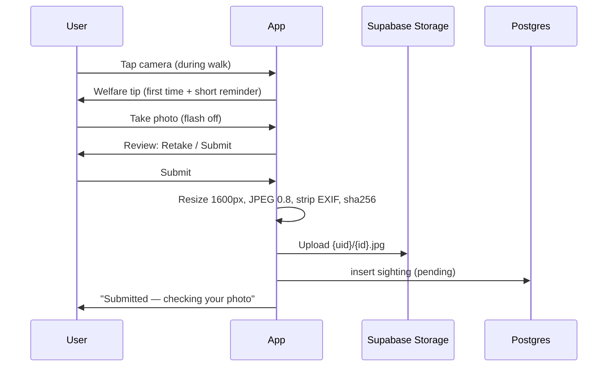

# Phase 6 — In-App Cat Camera & Sighting Submission

## Goal
From an active walk (or a "Spotted a cat" action), the user opens the in-app camera, takes a photo **without flash**, reviews it, and submits it as a sighting. The photo is compressed, stripped of metadata, uploaded to private storage, and recorded with status `pending`. Validation itself is Phase 7.

## Prerequisites
- Phase 3 (active walk with camera placeholder button).

## Out of scope
- Cat detection, duplicate detection, rate limits, points (Phase 7 / 9).
- Collection UI (Phase 8).
- Gallery uploads (explicitly excluded from MVP).

## Packages
```bash
npx expo install expo-camera expo-image-manipulator expo-crypto expo-file-system
```
`app.json` `expo-camera` plugin: `cameraPermission` text ("…to photograph cats you spot on your walks. Photos stay private unless you choose to share."). **No microphone permission** (`recordAudioAndroid: false`, no mic text). Rebuild dev client.

## Data / schema
Migration `<ts>_sightings.sql`:
- `sightings`: `id uuid pk` (client-generated → idempotent), `user_id`, `walk_id uuid null references walks`, `photo_path text`, `sha256 text`, `phash text null` (filled in Phase 7), `taken_at timestamptz`, `area_geohash text null` (max 5 chars ≈ 5 km cell, only if user opted in), `status text default 'pending' check in ('pending','accepted','rejected','flagged')`, `reject_reason text null`, `cat_confidence numeric null`, `cat_id uuid null` (Phase 8), `created_at`.
- Unique: `(user_id, sha256)` → exact duplicates blocked at DB level.
- RLS: owner `select/insert/delete`; **no client update of `status`/`cat_confidence`** (only server).
- Storage bucket `sighting-photos` (private). Policy: users can upload/read/delete only under `{auth.uid()}/…`.

## Flow



## Tasks
- [x] 6.1 **Welfare sheet** (shown first time, then a one-line reminder on the camera screen): keep your distance, no flash, don't touch/chase/feed, never enter private property. "Got it" stores acknowledgement.
- [x] 6.2 **Camera screen** `src/app/sighting/capture.tsx` (modal): `CameraView` with `flash="off"` hard-coded (no toggle), zoom slider (encourage zoom instead of approaching — hint text "Use zoom, not your feet 🐾"), shutter button, close. Permission denied state with Settings link.
- [x] 6.3 **Review screen:** full photo, Retake / Submit. Optional "Save general area" toggle (default from privacy setting, default **off**) → if on, get one current location and store only a 5-char geohash (pure function `toGeohash(lat,lng,5)`, tested).
- [x] 6.4 **Processing** `src/features/sightings/process.ts`: resize longest side to 1600 px, JPEG quality 0.8 via image-manipulator (this drops EXIF/GPS metadata — verify), compute SHA-256 of the processed file with `expo-crypto`.
- [x] 6.5 **Offline-safe upload queue** (reuse the Phase 3 `pending_uploads` pattern): save processed file into app document directory + queue row; upload when online; delete local copy after success.
- [x] 6.6 Insert `sightings` row with `walk_id` when taken during a walk; handle unique-violation on `sha256` → "You already submitted this photo".
- [x] 6.7 Enable the camera button on the active walk screen; add a "Spotted a cat" button on Home for sightings outside a walk (walk_id null).
- [x] 6.8 Walk summary lists photos taken during the walk with status chips (`Checking…`).
- [x] 6.9 Client-side guardrails: max 1 capture per 10 s (debounce), images < 10 MB, reject if dimensions < 400 px.

## Acceptance criteria
- [x] Photo can be taken from an active walk and from Home; flash is never used.
- [x] Uploaded file has no EXIF GPS data (verify by downloading and inspecting).
- [x] Offline submission uploads later exactly once.
- [x] Submitting the identical file twice is blocked.
- [x] Other users cannot access the photo URL (signed URLs only, private bucket).
- [x] No microphone permission requested.

## Manual test script
1. Start a walk → camera → welfare sheet → take photo → review → submit → "Checking…".
2. Airplane mode → take photo → submit → reconnect → appears uploaded.
3. Deny camera permission → helpful state.
4. Download photo from Supabase dashboard → check no location metadata.

## Pitfalls
- Display private photos via **signed URLs** (`createSignedUrl`, cache ~1 h) with `expo-image`.
- Camera screen must release the camera on blur/unmount (battery).
- Do not attach precise lat/lng to the sighting — ever.
