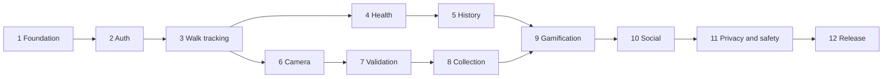

# StrayCat Walk — Build Plan

> Working title. Product source of truth: [`product-overview.md`](./product-overview.md).
> This folder breaks the product into **small, self-contained phases** so an AI (or a human) can build one phase at a time without breaking the rest.

---

## How to use these docs

1. **Always read first:** [`00-architecture.md`](./00-architecture.md) (stack, folders, data model, golden rules). It applies to *every* phase.
2. **Then read only the current phase file.** Do not read ahead and do not build features from future phases.
3. **Build the tasks in order**, check them off in the phase file, and verify every acceptance criterion.
4. **Run the quality gate** before calling a phase done:
   ```bash
   npx tsc --noEmit
   npx expo lint
   npx jest            # once tests exist (from Phase 1)
   ```
5. **Update [`PROGRESS.md`](./PROGRESS.md)** — mark the phase done, note any decisions or deviations.
6. Commit with a conventional message, e.g. `feat(walk): phase 3 GPS walk tracking`.

### One phase = one AI session

Start a fresh conversation per phase (or use `/compact` between phases). Paste this prompt:

```text
We are building StrayCat Walk (Expo SDK 58, Expo Router, NativeWind, Supabase).
Read docs/00-architecture.md and docs/PROGRESS.md, then implement ONLY
docs/<PHASE_FILE>.md.

Rules:
- Do not implement anything listed under "Out of scope" for this phase.
- Do not refactor code from earlier phases unless a task explicitly says so.
- Before using any Expo/React Native API, check the SDK 58 docs
  (https://docs.expo.dev/versions/v58.0.0/) — do not rely on memory.
- Install packages with `npx expo install`.
- Finish by running tsc, lint and tests, then tick the checklist in the phase
  file and update docs/PROGRESS.md.
```

---

## Phase map

| # | Phase | File | Depends on | Needs dev build? |
|---|---|---|---|---|
| 0 | Architecture & rules (read every time) | [00-architecture.md](./00-architecture.md) | — | — |
| 1 | Foundation: design system, navigation shell, tooling | [01-foundation.md](./01-foundation.md) | — | Yes (created here) |
| 2 | Backend, auth & profile | [02-auth-and-profile.md](./02-auth-and-profile.md) | 1 | No |
| 3 | GPS walk tracking (core) | [03-walk-tracking.md](./03-walk-tracking.md) | 2 | **Yes** |
| 4 | Steps & calories (HealthKit / Health Connect) | [04-health-steps-calories.md](./04-health-steps-calories.md) | 3 | **Yes** |
| 5 | Walk history & activity dashboard | [05-history-dashboard.md](./05-history-dashboard.md) | 3, 4 | Yes |
| 6 | In-app cat camera & sighting submission | [06-cat-camera-sightings.md](./06-cat-camera-sightings.md) | 3 | Yes |
| 7 | Sighting validation backend | [07-sighting-validation.md](./07-sighting-validation.md) | 6 | No |
| 8 | Personal cat collection | [08-cat-collection.md](./08-cat-collection.md) | 7 | No |
| 9 | Points, achievements & challenges | [09-points-achievements-challenges.md](./09-points-achievements-challenges.md) | 5, 8 | No |
| 10 | Friends & leaderboards | [10-friends-leaderboards.md](./10-friends-leaderboards.md) | 9 | No |
| 11 | Privacy, safety & moderation | [11-privacy-safety-moderation.md](./11-privacy-safety-moderation.md) | 10 | No |
| 12 | Polish, analytics & beta release | [12-polish-analytics-release.md](./12-polish-analytics-release.md) | 11 | Yes |
| — | Post-MVP backlog (do **not** build in MVP) | [99-later-phases.md](./99-later-phases.md) | — | — |



> Phases 4 and 6 are independent after Phase 3 — they can be built in either order.

---

## Structure of every phase file

Each phase file uses the same sections so the AI always knows where to look:

- **Goal** — the one outcome this phase delivers.
- **Prerequisites** — what must already exist.
- **Out of scope** — things the AI must *not* build yet.
- **Packages** — what to install (always via `npx expo install`).
- **Data / schema** — tables, migrations, types introduced.
- **Tasks** — ordered checklist.
- **Acceptance criteria** — how we know it's done.
- **Manual test script** — what to try on a real phone.
- **Pitfalls** — known traps.
